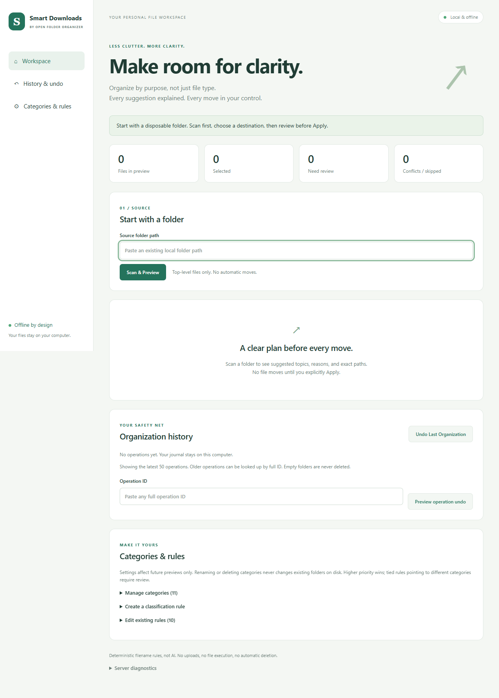

# Smart Downloads Manager

An offline-first Windows utility built on **Open Folder Organizer**. Organize
downloads by purpose and subject, inspect every suggestion, and restore individual
files or whole operations when it is safe. Python's standard-library HTTP server,
SQLite, and a small amount of HTML/CSS/JavaScript power the local dashboard.
Built for Windows users who want a readable plan before organizing files, with
an audit trail and a safe way to undo changes.



[View the mobile dashboard](docs/screenshots/mobile.png).

## Technology stack

| Area | Implementation |
|---|---|
| Runtime | Python 3.12+; standard library only for the supported app |
| Local server | `http.server.HTTPServer`, bound to loopback |
| Interface | Server-rendered HTML, CSS, and vanilla JavaScript |
| Storage | SQLite settings and operation journal |
| Classification | Deterministic filename/extension rules; no AI service |
| Integrity | SHA-256 plus filesystem identity and metadata |
| Verification | `unittest`, real HTTP tests, optional Playwright + Chrome |

## Run locally

Requires Python **3.12+**. No package installation, API key, cloud service, or
administrator access is needed for the supported browser UI.

Clone the repository (or download and extract its ZIP), then open a terminal in
the project folder:

```powershell
git clone https://github.com/Ankit70842/smart-download-manager.git
cd smart-download-manager
```

```powershell
python web_app.py
```

Open **http://127.0.0.1:8501**. Stop with Ctrl+C. If the port is occupied:

```powershell
python web_app.py --port 8502
```

Start it in your **own normal terminal**, not an automation sandbox. The console
and **Server diagnostics** show the actual OS process account and interpreter.
The server binds only to `127.0.0.1`; do not expose it to a network or deploy it as
a public website. No folder is scanned or organized automatically at startup.

## Everyday workflow

1. **Scan Downloads.** Downloads is prefilled; expand **Change folder** to use a
   different source. Prefilling does not scan or even check that folder. Reading
   starts only when you click Scan.
2. **Review suggested folders.** A compact category summary shows where files will
   go. Safe, high-confidence suggestions start selected. Medium-confidence,
   uncertain, incomplete, and conflicting suggestions are left out by default.
3. **Organize.** Keep files inside the source or choose **Another folder**. Click
   **Organize**, review the destination and counts, then **Confirm & Organize**.
   This is the single final move confirmation; there is no extra checkbox.

Need more control? Expand **Edit Details** for individual files, exact paths,
search, filtering, sorting, selection, and bulk changes. **Filtering only hides
rows**; it does not exclude files. Custom categories and rules live under
**Advanced**. Changing a destination is retained when saving advanced edits.

**Undo Last** is always prominent. It shows a restore preview before **Confirm
restore**. Expand **History** for older operations and individual-file undo.
Long operation IDs are kept in technical details, not the main screen.

The default is the current user's `Downloads` directory under their home folder;
if Windows has redirected it elsewhere, use **Change folder**. Pasting a path is
the supported safe equivalent to a folder picker; the app does
not require desktop-dialog integration. Each file's destination is the explicitly
chosen root + editable category/subcategory + unchanged original filename.

## Explainable classification

- Categories: **Studies, Projects, Personal, Games, Installers, Media, Unsorted**.
- Built-in study subjects: **Computer Networks, DBMS, Operating Systems, Maths**.
- Related PDFs, PPTX, DOCX, TXT, and other formats can share the same subject
  folder: `Computer Networks notes.pdf` and `CN lecture.pptx` both match networking.
- Rules use normalized filename words/phrases and optional extension filters.
  Keywords match any listed phrase; when extensions are supplied, they must also
  match. Higher integer priority wins. Conflicting categories at equal priority
  result in **Unsorted / Needs review**.
- **High**, **Medium**, **Needs review**, and **User choice** are explanatory rule
  labels, not probabilities or claims of AI accuracy. Each result shows its reason.
- No document-text extraction, model, chatbot, network lookup, or downloaded-file
  execution is used. Classification examines filenames, not document contents.

## Custom categories and rules

Under **Advanced → Categories & rules**, create nested paths such as `Studies/AI`, rename
categories, or delete them from settings. Deleting a parent also removes its nested
settings categories and associated rules. **Existing folders/files are never
renamed or deleted by a settings action.** `Unsorted` remains available.

Create/edit rules with an ID, category, comma-separated keywords, optional
extensions, and priority (-1000 to 1000). Case-insensitive category conflicts,
traversal components, invalid Windows names, and reserved device names are rejected.
Settings persist in SQLite and take effect after a new scan; changing settings
invalidates an old preview.

Correcting a preview does **not** teach a rule automatically. Under Advanced, the
**Save a filename correction as a rule** panel requires approval and
saves the selected filename stem as a keyword at priority 200. Review the category
and filename before saving a potentially broad keyword.

## Safety, history, and undo

- Source scanning is top-level only. Existing directories (including category
  folders such as Code and Documents) are excluded entirely from file suggestions,
  with a separate untouched-folder count. Links, dot-prefixed files, incomplete
  downloads, unreadable files, and detected locks are skipped with explanations.
- Source identity, size, and modification time are checked again before Apply.
- Existing destination files are **never overwritten**. Symlink/junction category
  paths and destinations outside the selected root are rejected.
- Same-filesystem moves create an exclusive hard link before removing the original
  name. Where links are unsupported or the destination is on another filesystem,
  an exclusive copy is flushed and verified before the source is removed.
- Each move records operation ID, UTC timestamp, original/destination paths,
  SHA-256, destination identity, status, and errors. Destination identity is
  journaled before the original name is removed, so interrupted work can recover.
- Undo rechecks contents, identity, original-path availability, and parent paths.
  Edited, replaced, missing, manually moved, or locked files are skipped safely.
  Partial undo and repeated undo are supported without overwriting restored files.
- Ambiguous failures, including a partial copy, preserve files and are marked
  **review**. Inspect both paths manually; the app does not guess which to delete.
- Existing journals migrate without deleting their entries. Legacy entries lack
  new identity/timestamp data; legacy undo uses the original hash/path safeguards.
- The active journal and sidecars cannot be selected for organization. Empty
  category folders and unrelated files are not deleted during undo or cleanup.

Data and settings live in `.organizer/history.sqlite`. Keep `.organizer` to retain
undo/history and custom settings; it is ignored by Git because it contains local
paths. For an isolated demo database:

```powershell
python web_app.py --port 8502 --database .runtime/demo-history.sqlite
```

Host/Origin checks, unpredictable form tokens, escaped HTML, parameterized SQL,
bounded request bodies, a same-origin-only asset policy, stale-preview IDs, and
explicit confirmations protect local browser operations. They do not isolate the
app from malicious programs running as your own user.

## Try disposable files first

```powershell
python scripts/create_smart_demo.py
```

The script prints new source/destination paths and writes a manifest under a new
temporary directory. It includes a collision, an uncertain file, an incomplete
download, and a subfolder to demonstrate exclusions. Its PDF/PPTX/image/video/EXE
files contain harmless **placeholder text**; they are never opened as documents or
executed. Your actual Downloads folder is not accessed.

## Legacy CLI and experimental Streamlit

The original extension-based CLI remains available for backward compatibility;
it does **not** use smart topic rules:

```powershell
python -m organizer "C:\Path\To\DisposableFolder"
python -m organizer "C:\Path\To\DisposableFolder" --apply
python -m organizer --history
python -m organizer --undo
```

CLI Apply requires typing `APPLY`. Use `--database PATH` consistently for an isolated
CLI journal. The CLI's `--undo` explicitly requests the original immediate undo
behavior; restore-preview confirmation is a browser UI feature.

`app.py` and `requirements.txt` are an **experimental, unsupported legacy Streamlit
frontend**. They are not the working smart dashboard or a verified installation
target. See [Streamlit notes](docs/EXPERIMENTAL_STREAMLIT.md).

## Tests and architecture

```powershell
python -m unittest discover -s tests -v
python -m compileall -q web_app.py organizer scripts tests
node --check assets/app.js
```

Node is only needed for the optional JavaScript syntax check/browser tooling.
The automated suite uses disposable folders and isolated databases. It covers
classification, settings persistence, nested destinations, migration, collisions,
locks, partial copies, replaced/edited files, restart persistence, historical and
individual undo, and HTTP validation. One real-symlink test requires Windows
permission and may be skipped.

See [verification results](VERIFICATION.md), [design and tradeoffs](docs/SMART_DESIGN.md),
and [review findings](QUALITY_REVIEW.md). The reusable Playwright scenario and
setup instructions are in [browser verification](docs/BROWSER_TESTING.md).

The included GitHub Actions workflow runs the Python suite and syntax checks on
Windows with Python 3.12 and 3.13. Browser checks remain a separate local workflow.
The workflow is configured; its first hosted result is pending publication. No
passing CI badge or hosted build result is claimed here.

## Project structure

```text
smart-download-manager/
├── web_app.py                 # Local HTTP entry point and request protection
├── organizer/
│   ├── actions.py             # Scan, review, confirm, settings, and undo flows
│   ├── smart.py               # Editable smart previews and file selection
│   ├── rules.py               # Explainable filename classification
│   ├── settings.py            # Persistent categories and rules
│   ├── history.py             # Migration, safe transfer, journal, and undo
│   ├── paths.py / access.py   # Destination boundaries and Windows access checks
│   ├── ui.py                  # The simple three-step interface
│   └── core.py / __main__.py  # Legacy extension-based CLI
├── assets/                    # Local CSS, JavaScript, and icon
├── scripts/                   # Disposable demo generators
├── tests/                     # Unit, HTTP, filesystem, and browser checks
├── docs/                      # Screenshots, architecture, and browser instructions
├── .github/workflows/tests.yml
├── app.py / requirements.txt  # Experimental legacy Streamlit frontend
└── LICENSE                    # MIT
```

The ignored `.organizer/` and `.runtime/` directories are local state and test
output, not distributable project data. See [SECURITY.md](SECURITY.md) for the
trust boundary, private-data handling, and reporting guidance.

## Practical limits

- Use trusted, idle local folders. Checks cannot eliminate hostile filesystem races
  or guarantee recovery after physical storage failure. This is not a backup tool.
- A scan previews at most **1,000 top-level entries**, with a visible truncation
  notice. The dashboard shows the latest **50 operations**; older operations can
  be looked up using their full saved ID. The underlying journal has no retention
  policy and is still read in full for history grouping.
- Operations are synchronous. The UI shows indeterminate progress and success
  totals; it does not report fabricated percentage progress. Large hashes/copies
  can delay requests. No background watcher or automatic organization is provided.
- A lock acquired after the scan may still cause Apply to fail; records/files are
  preserved. Cross-filesystem fallback has fault-injected tests, not physical
  multi-drive hardware coverage. Copy does not preserve all filesystem metadata.
- Network paths, recursive organization, automatic duplicate deletion, document
  content extraction, filename renaming, and arbitrary per-file external roots are
  outside this version. Per-file categories can differ under the chosen root.
- A single local workspace/preview is shared across tabs; changing it invalidates
  stale forms. This is a personal tool, not a multi-user server.

If Apply reports access denied, inspect the named operation and **Server
diagnostics**. A sandbox-owned server can have less access than your terminal.
Start `python web_app.py` as your normal user; do not run as administrator or weaken
Windows security to make it work.

## Small roadmap

Optional future work: a native folder picker, paginated journal queries, and
measured progress for long operations. These are not implemented features.

## License

[MIT License](LICENSE) — Copyright (c) 2026 Ankit Chaurasia.
