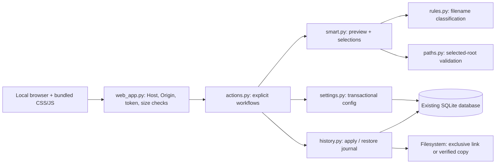

# Smart Downloads Manager design

The original HTTP server and SQLite journal remain. Classification, editable
preview state, settings, actions, and rendering are separated because adding all
of them to the original server file would make it difficult to test and maintain.

The simplified UI has three steps: Scan Downloads → Review suggested folders →
Organize. The home Downloads path is only prefilled; no scan occurs automatically.
Normal review is grouped by category, with high-confidence safe suggestions
selected. Directories are excluded from file entries entirely. All power controls
remain available under Edit Details or Advanced, and history starts collapsed.
Organize prepares a server-side confirmation snapshot; the final button consumes
its nonce and reuses the existing apply/journal safeguards. Canceling or editing
invalidates that confirmation. No extra movement checkbox is required.

## Components

- `rules.py`: normalized whole-word/phrase matches, priorities, uncertainty, and
  Windows category-name validation. No classifier executes or parses documents.
- `settings.py`: validated configuration in a singleton SQLite JSON row, changed
  within a transaction. Category settings never rename/delete filesystem folders.
- `smart.py`: scan snapshot, per-file selections and categories, explicit root
  choice, and construction of immutable `Move` requests. Preview is read-only.
- `paths.py`: local absolute roots and nested boundary/link checks.
- `access.py`: non-destructive Windows read/delete-sharing checks using CreateFileW.
  See [Microsoft documentation](https://learn.microsoft.com/en-us/windows/win32/api/fileapi/nf-fileapi-createfilew).
- `history.py`: backward-compatible journal migration; durable pending/undoing
  records; file fingerprints and identity; no-overwrite transfer; partial undo.
- `actions.py` and `ui.py`: form workflows and escaped server rendering.
- `assets/`: small local style/script enhancement. File safety stays in Python;
  JavaScript only filters/sorts/selects rows and displays loading feedback.

## Request example

`CN lecture.pptx` → filename rule → `Studies/Computer Networks` with an explanation.
The user chooses a destination root, edits/excludes entries if needed, reviews
exact paths, and explicitly Applies. A pending journal row precedes any transfer.
The destination's identity is saved before unlinking the source name. Successful
transfers become `moved`; ambiguous partial transfers become `review` after
reconciliation. Undo first previews safety checks, then rechecks when confirmed.

## Data compatibility and tradeoffs

The existing `moves` table is retained, with additive `created_at`,
`destination_identity`, and `restore_identity` fields. New rows get UTC timestamps.
Old rows keep their paths, hashes, statuses, IDs, and operation IDs. Missing legacy
identity/timestamps are not invented. Legacy `scan()`/CLI/Streamlit keep extension
classification; the smart dashboard uses a separate preview API.

Same-volume hard links avoid copying large files. For a different filesystem or
unsupported link operation, exclusive copying avoids overwrites but costs time,
extra disk space, and additional hashing. A failure leaves original/partial data
for manual review instead of deleting potentially useful evidence.

One synchronous local process keeps the architecture understandable and journal
ownership simple. It limits responsiveness during long operations. The loading
indicator is indeterminate; worker queues and measured progress are deliberately
not claimed. Journal grouping still loads all history even though rendering is
limited to 50 operations.

## Trust boundaries

Websites and filenames are untrusted: HTML is escaped, dynamic SQL values are
bound, static files use a fixed allowlist, and local forms require Host/Origin and
token checks. Downloaded files are never executed. Other programs running as the
same OS user and hostile concurrent filesystem mutation are outside the boundary.
No permissions are granted, disabled, or elevated by the application.
